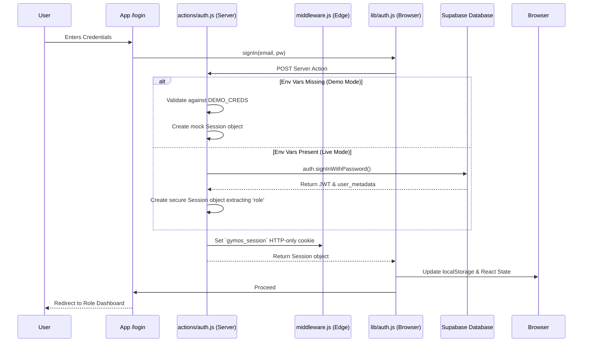

# GymOS Authentication Flow architecture

This document outlines the Phase 1 hybrid authentication architecture linking Next.js App Router (SSR) with Supabase Auth, while maintaining the Demo Mode fallback.

## Architecture Diagram

## State Synchronization

GymOS uses a **dual-state synchronization mechanism** to bridge classical SSR route protection with modern Supabase hooks:

### 1. Edge Protection (Middleware)
- The edge middleware (`middleware.js`) acts as a secure bouncer.
- It intercepts every request.
- It calls `updateSession(request)` from `@supabase/ssr` to ensure standard JWT token refresh.
- It also reads the `gymos_session` HTTP-only cookie to determine the `role`.
- It enforces cross-boundary navigation rules (e.g., a `member` cannot access `/dashboard`).

### 2. Browser Hydration (Context)
- On the client side, `AuthProvider` in `lib/auth.js` bootstraps from `localStorage` for zero-layout-shift (ZLS) rendering.
- Wait in the background, it mounts a `supabase.auth.onAuthStateChange` listener.
- If a token refresh occurs, or the user signs out from another tab, the listener immediately updates React state and `localStorage` to keep the UI perfectly synced with the true Supabase session.

## Role-Based Routing Rules

Once a session is established and placed into the `.gymos_session` cookie, the edge middleware enforces the following redirect rules:

| Role Identifier | Allowed Base Paths | Protected Base Paths | Redirect Target on Auth Failure |
|-----------------|---------------------|----------------------|---------------------------------|
| `super_admin`   | `/super-admin` | All | `/login?next=…` |
| `owner`         | `/dashboard`, `/analytics`, `/members`, `/settings` | `/super-admin` | `/dashboard` |
| `trainer`       | `/trainer` | `/super-admin`, `/dashboard` | `/trainer` |
| `member`        | `/portal` | `/super-admin`, `/dashboard`, `/trainer` | `/portal` |

## Future Extensibility (Phase 2)
Currently, role logic reads directly from `user_metadata.role`. As GymOS connects the dashboards themselves to Supabase (Phase 2), we recommend attaching a PostgreSQL RLS (Row Level Security) policy directly querying this metadata value, eliminating permission checks at the API layer.
