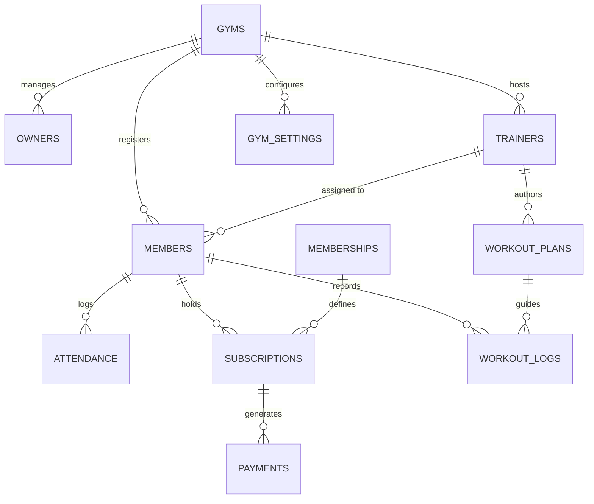

# GymOS Database Schema Architecture

The backend of GymOS runs on a multi-tenant PostgreSQL database via Supabase. All entities are securely isolated and intrinsically linked back to their respective gym instance. 

## ERD (Entity Relationship Diagram) Overview

## Schema Entities

> [!NOTE]
> All tables below contain `created_at`, `updated_at`, and `created_by` audit logging fields. Every table acts as a child of the `gyms` core tenant wrapper.

### 1. Tenants & Staff
| Table | Use Case | Key Relationships |
|-------|----------|------------------|
| `gyms` | Master tenant wrapper identifying physical locations or businesses. | Core entity. Parent to all below. |
| `owners` | Users given overarching management rights for a Gym profile. | Maps auth.user UUID directly. Child of gym_id. |
| `trainers` | Coaching staff given visibility into their assigned subsets of members. | Child of gym_id. |
| `members` | The core client unit paying for services and taking action. | Child of gym_id, Optional FK to trainers_id. |

### 2. Physical & Virtual Operations
| Table | Use Case | Key Relationships |
|-------|----------|------------------|
| `attendance` | Highly repetitive inserts whenever a user checks in via RFID or app. | Child of member_id AND gym_id. |
| `workout_plans` | Templates or customized routines tailored to individuals built by Trainers. | Child of gym_id author/member FKs. |
| `workout_logs` | Actual member execution of workouts, mapping calories, duration. | Child of workout_plans AND member_id. |

### 3. Monetization & Subscriptions 
| Table | Use Case | Key Relationships |
|-------|----------|------------------|
| `memberships` | Financial tiers (e.g., Gold, Premium) defined by the owner. | Child of gym_id. |
| `subscriptions` | An active relationship between a Member and a Membership tier spanning a period. | Joins member_id to membership_id. |
| `payments` | Immutable transaction ledger for tracking monetary success per subscription. | Child of subscription_id AND member_id. |

### 4. Admin Integrations & System
| Table | Use Case | Key Relationships |
|-------|----------|------------------|
| `gym_settings` | Determines UI (White Label colors, branding, alerts) per tenant. | One-to-One strict bound on gym_id. |
| `notifications` | Highly granular internal mail/alert logic pushed by system rules. | Child of auth.users target ID. |
| `activity_logs` | Deep audit trail preventing malicious internal edits or mistakes (e.g. "x deleted y plan"). | Broad tenant scope on gym_id. |
| `biometric_providers` | OAuth keys/API configs linking systems like Brivo/KISI. | Child of gym_id. |

## Implementation Constraints
- **Foreign Keys**: Designed defensively; e.g., deleting a Gym `ON DELETE CASCADE` instantly destroys all child rows without leaving ghost data, but deleting a Membership tier is `RESTRICTED` if active subscriptions are tied to it.
- **Indexes**: Explicit `CREATE INDEX` runs have been attached to every `gym_id`, `member_id`, and `user_id` Foreign Key field due to heavily read-reliant Dashboard dashboards rendering aggregations.
